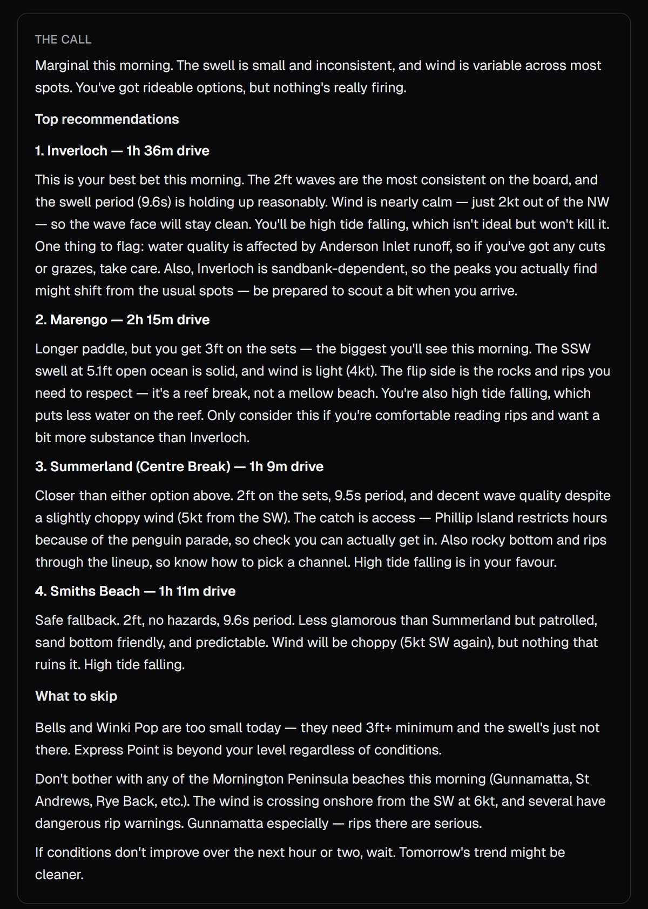
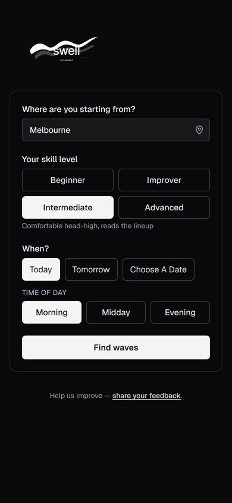
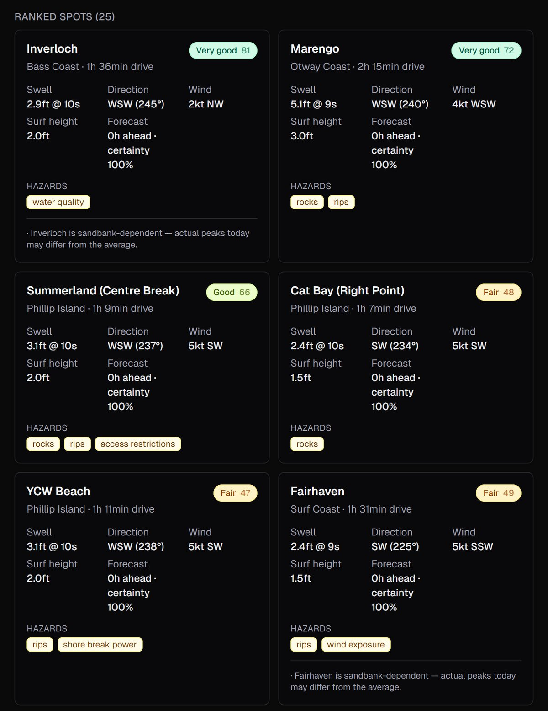

# Swell: an AI surf guide for Victoria

**Live:** [surf-app-eta.vercel.app](https://surf-app-eta.vercel.app)

Tell it where you're starting from, your skill level and when you want to go. Swell pulls live ocean forecasts, scores 39 Victorian breaks, and tells you where to surf in plain English, including where *not* to go and why.

Honest output, not hype. If conditions are mediocre it says so, and if a famous spot is firing but above your level it tells you and suggests somewhere better.

<p>
  
  
</p>



## Highlights

- **A real scoring engine, not a chatbot guess.** An 8-layer model scores every spot on swell direction, period and size, wind, tide, crowd, forecast certainty and drive time, after 7 hard safety gates.
- **Physics-based surf height.** Breaking-wave height uses the Komar & Gaughan (1972) formula, calibrated against observed surf heights, then shown in the traditional/Hawaiian scale surfers actually use.
- **Safety first.** Skill-specific hazard gates (rips, rocks, shore-break power, access) keep beginners off dangerous breaks, with 14 safety-critical scenarios under test.
- **Live data.** Open-Meteo marine, wind and tide forecasts with a 30-minute cache, plus Australia-only geocoding.
- **Feels instant.** Ranked spots stream to the page straight away. Claude's write-up then streams in token by token, and falls back to a deterministic summary if the AI is unavailable.
- **276 unit tests,** strict TypeScript, and lint-clean.

## Stack

- Next.js 16 (App Router, TypeScript strict, Turbopack)
- React 19
- Tailwind CSS v4
- Open-Meteo Marine + Forecast + Geocoding APIs (no API key needed)
- Anthropic API (`claude-sonnet-4-6`) for narration, with prompt caching
- Vitest for the unit-test suite
- Vercel for hosting

## Setup

```bash
npm install
cp .env.local.example .env.local
# edit .env.local — paste your ANTHROPIC_API_KEY (no quotes, no spaces)
npm run dev
```

Open http://localhost:3000.

## Environment variables

| Variable | Required | Purpose |
|---|---|---|
| `ANTHROPIC_API_KEY` | yes | Used by `lib/narration/client.ts` for the recommendation narration. Without it the route still works but renders a deterministic non-AI fallback. |

Open-Meteo APIs do not require a key.

## Scripts

| Command | Purpose |
|---|---|
| `npm run dev` | Next.js dev server on `:3000` |
| `npm run build` | Production build |
| `npm start` | Run the production build |
| `npm test` | Run the full Vitest suite (276 tests) |
| `npm run test:watch` | Vitest in watch mode |
| `npm run lint` | ESLint |
| `npx tsx scripts/smoke-conditions.ts` | Probe Open-Meteo at Bells with raw HTTP and confirm field names + null counts. Useful as a calibration aid. |
| `npx tsx scripts/smoke-narration.ts` | One-shot narration call against a hardcoded sample. Prints the prose; falls back to deterministic output when `ANTHROPIC_API_KEY` is unset. |
| `npx tsx scripts/smoke-api.ts` | End-to-end smoke against `/api/recommend`. Requires `npm run dev` running in another terminal. |

## Architecture

```
app/
  page.tsx                    Client component — input form + streaming results
  api/recommend/route.ts      POST orchestrator, NDJSON streaming response
  layout.tsx, globals.css
data/
  spots.ts                    Single source of truth (27 parents + 12 sub-breaks)
lib/
  types.ts                    Type contracts across all layers
  config.ts                   ALL tunable thresholds, weights, curves
  conditions/
    openMeteo.ts              Marine + Forecast clients, 30-min TTL cache
    geocoding.ts              Geocoding (Australia-only)
    cache.ts                  TtlCache utility
  scoring/
    gates.ts                  Layer 1 — 7 hard gates
    swellQuality.ts           Layer 2 — direction × period × size composite
    windFactor.ts             Layer 3 — direction × strength multiplier
    tideFactor.ts             Layer 4 — live tide phase + direction vs spot preference
    crowdFactor.ts            Layer 5 — base + modifiers + skill-relative
    certainty.ts              Layer 6 — forecast horizon decay
    driveTime.ts              Layer 7 — haversine + capped curve
    composite.ts              Layer 8 — final score + firing flag + category
    hazards.ts                Predicate registry (gating vs warning)
    geometry.ts               Compass utilities
    effectiveSize.ts          Komar–Gaughan breaker height (calibrated)
    index.ts                  Public scoreAll() orchestrator
  narration/
    prompt.ts                 System prompt (verbatim from spec + tide addendum)
    client.ts                 generateNarration() + streamNarration()
    fallback.ts               Deterministic narration when API fails
  utils/haversine.ts
specs/                        Four canonical design documents
tests/                        Vitest suite, organised by layer
scripts/                      Smoke / calibration scripts
```

### Streaming wire format

`POST /api/recommend` returns `application/x-ndjson` on success — a sequence
of newline-delimited JSON frames in this order:

1. `{ "type": "result", "result": { ... } }` — the structured
   `RecommendationResult`. Sent immediately after scoring (the user sees the
   ranked spots before any AI work begins).
2. `{ "type": "delta", "text": "..." }` — narration tokens, repeated as
   Claude streams.
3. `{ "type": "done", "fallback": false }` — terminator. `fallback: true`
   means the narration text was generated locally because the Anthropic call
   failed or `ANTHROPIC_API_KEY` was unset.

Validation errors (4xx) and conditions-unavailable errors (503) return a plain
JSON body, not the streaming format.

## Where to tune the algorithm

Every threshold, weight, and curve in the scoring engine lives in
**`lib/config.ts`** as a named exported constant. Edit values there; do not
change them inline in `lib/scoring/`. After tuning, re-run `npm test` and the
manual scenarios in `tests/scenarios.md`.

## Specs

The canonical design documents are in `specs/`:

- `victorian_surf_spots_v2.md` — spot DNA database
- `scoring_algorithm_spec_v2.md` — deterministic scoring
- `narration_prompt_spec.md` — the AI narration system prompt

Re-read these before making non-trivial changes to the engine.

## Deploying to Vercel

The project is configured for Vercel out of the box — no `vercel.json` needed.

1. Push the repo to GitHub.
2. Import it via the [Vercel dashboard](https://vercel.com/new). Vercel
   detects Next.js automatically.
3. Set the `ANTHROPIC_API_KEY` environment variable in the Vercel project
   settings (Settings → Environment Variables) before the first deploy. The
   variable scope should include Production, Preview, and Development if you
   want it available everywhere.
4. Deploy.

The Open-Meteo APIs work from Vercel's edge runtime without any key or
configuration.

## v1 scope notes

- **Tide is not factored into v1 scores.** Spots with medium/high tide
  sensitivity carry a "verify tide tables" caveat in the per-spot output.
  The full tide-API integration is a v2 follow-up.
- **Drive time is haversine × average road speed**, capped at a 15-point
  ranking penalty. Road-network divergence doesn't change the top
  recommendation when wave-quality differences are meaningful.
- **Forecast horizon up to 7 days** (Open-Meteo limit). Beyond ~120 hours
  the certainty multiplier is below 0.70 and the narration explicitly hedges.

## v2 candidates

- Real tide forecasts (currently stubbed as factor=1.0).
- Multi-hub drive-time matrix (Melbourne / Geelong / Frankston / Warragul)
  if haversine accuracy proves insufficient during calibration.
- Real-time spot status (closures, sandbank reports).
- Additional spots (Warrnambool, Port Fairy, Wilsons Promontory).
- Personal preferences / saved searches.
